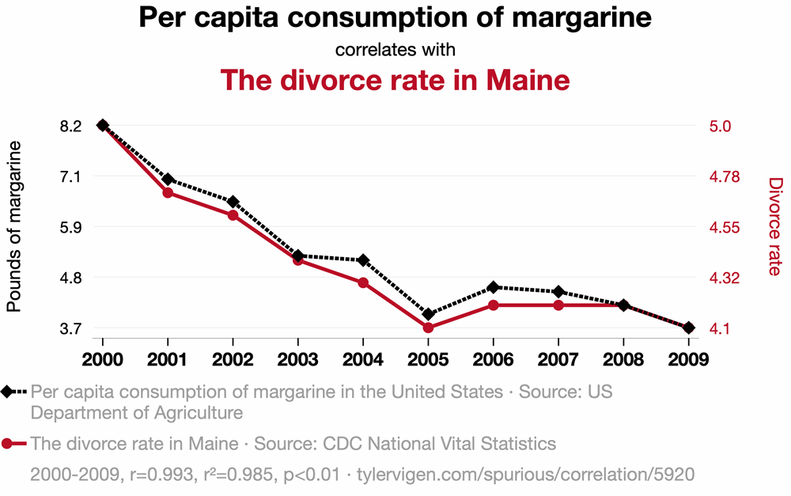
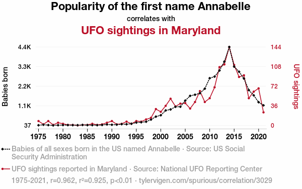
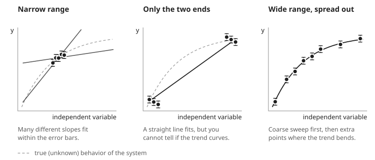
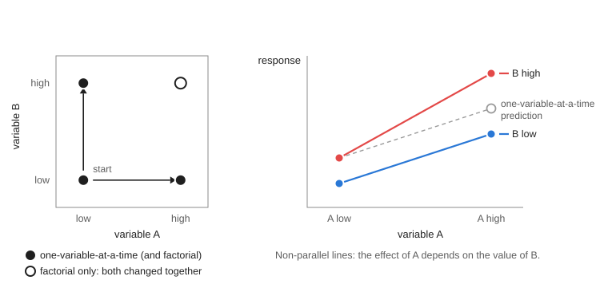

# Experimental Design

- [Why Experimental Design?](#why-experimental-design)
- [What Can Go Wrong?](#what-can-go-wrong)
- [Correlation Is Not Causation](#correlation-is-not-causation)
- [Case Study: Chocolate and Weight Loss](#case-study-chocolate-and-weight-loss)
- [P-hacking and Honest Reporting](#p-hacking-and-honest-reporting)
- [Explore Before You Commit](#explore-before-you-commit)
- [Choosing the Range of Your Independent Variable](#choosing-the-range-of-your-independent-variable)
- [One Variable at a Time vs. Factorial Designs](#one-variable-at-a-time-vs-factorial-designs)
- [Replicates and Run Order](#replicates-and-run-order)
- [Planning Your Investigation](#planning-your-investigation)
- [Further Reading](#further-reading)

## Why Experimental Design?

So far in Physics 50, your experiments have been fairly structured. The question, the apparatus, and much of the procedure were given to you, and your job was to carry out the measurements carefully and quantify their uncertainty. The Tech Report is more open-ended. You will define your own question, decide what to vary and what to measure, and carry out a procedure to address that question efficiently and quantitatively. You need to do all of this within about six hours of lab time.

That means that before your first Tech Report lab session, you are already making the decisions that determine whether your data can answer a scientific question at all. How you take your data matters at least as much as how you analyze it: no amount of careful fitting can rescue a data set that was taken in a way that cannot answer your question.

This reading introduces some principles of experimental design that will help you plan your Tech Report investigation. It should take about 35 minutes, including about 15 minutes for two short outside readings: a news article on spotting dubious claims, and a (deliberately flawed) research paper. In class, you will put these principles into practice using the solar panel apparatus and instructions from [Experimental Design During Lab](https://physics-50.github.io/Module-3/week1){:target="_blank"}. This also gives you first-hand familiarity with the solar panel setup in case you would like to use it for your Tech Report investigation.

## What Can Go Wrong?

Lesson check: Before reading further, take a minute to make a list. What could go wrong in an experiment that would lead you to an erroneous conclusion? Think beyond simple mistakes like misreading a meter.

 (think about it first, then click to expand/collapse) 
   

Answer:

There are many good answers. Here are three that occur frequently:

+ **Confirmation bias.** It is easy to see what you expect to see: to stop taking data once the result looks "right", or to look harder for problems in data that disagree with your expectations than in data that agree. Give your data room to tell their actual story, not the one you expected them to tell!
+ **Uncontrolled variables.** If something other than the quantity you are deliberately changing also changes between measurements (e.g. the room temperature, the alignment of the apparatus, or which lab partner takes the reading), then you cannot tell which change caused the effect you see.
+ **Mistaking correlation for causation.** Two quantities can rise and fall together without one causing the other.

Other good answers include a method that introduces too much uncertainty to test what you wanted to test, and a measurement that does not actually measure what you think it measures.

An uncontrolled variable that changes along with your independent variable, and also affects your dependent variable, is called a **_confounding variable_**. For example, suppose that in Module 2 you measured $$L$$ for your smallest values of $$x$$ first and your largest values last, and that partway through, your lab partner took over measuring $$L$$ and measured to the front of the grating mount instead of the back. That offset would affect only your later measurements, which are also the ones at large $$x$$. It would change the slope of your $$L$$ vs. $$x$$ plot, and therefore your value of $$d$$. Much of experimental design comes down to keeping confounding variables out of your data.

## Correlation Is Not Causation

When two quantities rise and fall together, they are **_correlated_**. A correlation can be a valuable clue, but on its own it does not tell you that one quantity causes the other. Consider the two plots below:

Nobody believes that eating margarine causes divorce in Maine. These plots come from Tyler Vigen, [tylervigen.com/spurious-correlations](https://tylervigen.com/spurious-correlations){:target="_blank"}, who wrote a script to harvest data from a bunch of publicly accessible databases and plot a bunch of things against each other until something (accidentally) correlated strongly. We will come back to this idea in the [section on p-hacking](#p-hacking-and-honest-reporting).

Notice also that each chart has two vertical axes, one for each quantity, with each scale chosen so that its curve fills the plot. Scaling the axes this way can make almost any two quantities that rise (or fall) over the same years look like they move together.

Some misleading correlations are not funny at all. Take about 5 minutes now to read [How to spot dubious claims in scientific papers](https://www.nature.com/nature-index/news/how-to-spot-dubious-claims-in-scientific-research-academic-papers){:target="_blank"}, a short article from _Nature Index_ that summarizes four red flags described by the biologist Carl Bergstrom and the data scientist Jevin West. The last example in the article is a 2015 paper that plotted autism prevalence and measles-mumps-rubella (MMR) vaccination coverage on two separately scaled axes. This separate scaling made the two variables seem strongly coupled, even though vaccination coverage barely changed over the years shown. The idea that the MMR vaccine causes autism traces back to a 1998 paper based on just 12 children, which was later retracted, and studies of hundreds of thousands of children have since found no link. Plots like this one help keep the claim alive anyway, with real consequences for public health.

What do you do with a correlation like this? **A correlation is the beginning of a study, not the end!** If you see a correlation, ask whether you can design a follow-up study to test whether there is causation, and whether there are any logical reasons to expect a causal relationship.

Lesson check: Each of the article's four red flags has a counterpart in the lab. For each one, think of how the same problem could show up in a Physics 50 experiment, or which idea in this reading guards against it.

 (think about it first, then click to expand/collapse)
   

Answer:

+ **Flawed data.** The "criminality" algorithm learned to tell frowning faces from smiling ones, because the two groups of photos differed in expression as well as in the quantity of interest. There was a confounding variable built into the data set. In the lab, the same thing happens if something you did not intend to vary changes along with your independent variable. A common-sense check also helps: estimate the answer before you take data, and ask whether your result is reasonable.
+ **Data censoring.** Leaving out data can change your conclusion. Exclude data only for a reason you can state, and say so when you report your results (see the [section on honest reporting](#p-hacking-and-honest-reporting)). Also ask what your data set _cannot_ show you: the musician study could only include musicians who had already died, just as your conclusions hold only over the range of conditions you actually tested.
+ **Spurious correlations.** Searching through many variables until something correlates is the same problem as p-hacking, described below.
+ **Axis manipulation.** The charts above use the same trick as the MMR plot: two separately scaled vertical axes. When you make your own plots, plot your data against the quantity you varied, on one clearly labeled vertical axis with error bars, and let a fit tell you how well the data follow a model.

Correlations can also point toward real causes. Global average temperature and the concentration of carbon dioxide in the atmosphere have risen together over the last century. In this case the correlation is backed by a well-understood physical mechanism, by comparisons between planets, and by many controlled experiments in the lab.

**This is where experimental design comes in.** In a designed experiment, you deliberately change one quantity (the **_independent variable_**) and measure its effect on another (the **_dependent variable_**), while holding everything else constant. When you cannot hold something constant (the room temperature, say, or the exact placement of the grating), you can still keep it from masquerading as the effect you are looking for: take your measurements in a random order, reset it between trials so that it adds random scatter rather than a systematic shift, or measure it so that you can account for it. The [section on replicates and run order](#replicates-and-run-order) describes these strategies in more detail. Data collected this way can establish cause and effect. Data collected by simply watching two quantities change together can only establish correlation.

--------

#### Mini-question 1: Flipped vs. Traditional Sections
[*Click here to open in a new tab*](https://docs.google.com/forms/d/e/1FAIpQLSeuXN2mTaBui3FioOavZNQI9VuXeJhYyi2W3mAw6hwExp4KAg/viewform){:target="_blank"}

<iframe src="https://docs.google.com/forms/d/e/1FAIpQLSeuXN2mTaBui3FioOavZNQI9VuXeJhYyi2W3mAw6hwExp4KAg/viewform?embedded=true" width="640" height="900" frameborder="0" marginheight="0" marginwidth="0">Loading…
</iframe>

--------

## Case Study: Chocolate and Weight Loss

In 2015, newspapers and websites around the world reported that eating chocolate can help you lose weight. The story was based on a real study with real data, published in a scientific journal.

Take about 10 minutes now to read the [study](images/Bohannon15.pdf){:target="_blank"}. As you read, list as many flaws as you can find in the design, analysis, and presentation of the experiment. Then compare your list with ours.

 (try it first, then click to expand/collapse) 
   

Some of the flaws:

+ **Very few participants.** The Methodology section never says how many people were in each group. A note under Table 3 reveals that only 5 people were in the chocolate group and 4 in the low-carb group. With so few people, ordinary day-to-day weight fluctuations are comparable to the differences between groups, and the groups could easily differ in age, sex, or starting weight.
+ **A small effect presented as a big one.** Figure 1 plots changes in weight in kilograms, which makes the groups look very different. The text reports that the chocolate group lost 3.2% of their body weight and the low-carb group lost 3.1%.
+ **The chocolate group was also on a low-carb diet.** So the study says nothing about eating chocolate on its own, yet that is how the result was reported.
+ **Many measurements, few subjects.** The study tracked weight, BMI, waist-to-hip ratio, cholesterol, triglycerides, several liver and blood values, ketones, sleep, and well-being, and then emphasized whichever results came out "significant". See the next section for why this matters.
+ **Hard-to-interpret figures.** What exactly is being compared in Figure 3?

You may well have found others.

In fact, the study was flawed _on purpose_. Its lead author, the science journalist John Bohannon, ran it to show how easily bad nutrition science gets published and reported. He describes how he did it in [this article](https://gizmodo.com/i-fooled-millions-into-thinking-chocolate-helps-weight-1707251800){:target="_blank"}: the paper was accepted by a journal that charged a fee and did no real peer review, and a press release that left out the number of participants was enough to spread the story around the world.

## P-hacking and Honest Reporting

How did a study with only 15 participants produce "statistically significant" results? Bohannon's team measured 18 different quantities on each participant. He compares each measurement to a lottery ticket. If each one has a 5% chance of looking significant purely by chance, then the probability that at least one of the 18 "wins" is
\begin{equation}
1 - (0.95)^{18} \approx 0.60. \nonumber
\end{equation}
When one did, it became the headline.

Trying many measurements, analyses, or subsets of the data, and then reporting only the ones that look significant, is called **_p-hacking_**. The spurious correlations above were found the same way, by plotting enough pairs of quantities against each other until some of them matched.

P-hacking is not limited to medicine. In a physics lab, the temptation can look like:

+ trying fit after fit, or dropping data points one at a time, until $$\chi_\nu^2$$ looks good or your result agrees with the accepted value;
+ reporting only the trial that "worked";
+ deciding what you were looking for after you have seen the data.

Some habits protect you (and anyone who relies on your results):

+ **Decide how you will analyze your data before you take it.** What will you plot, what function will you fit, and what result would answer your question?
+ **Record everything in your lab notebook,** including trials that did not work and the reasons for any changes you make along the way.
+ **Exclude data only for a reason you can state.** If you are aware that you have made a mistake, then you should repeat the measurement or at least exclude the data taken improperly -- and say so when you report your results.
+ **Report what you found,** even when it disagrees with what you expected.

#### No effect is still a result

Sometimes a careful experiment finds no difference. That is not a failure. A well-designed experiment that finds no significant effect tells you that any effect is smaller than your uncertainty, and that can be very valuable. One of the most famous results in physics, Michelson and Morley's search for the motion of the Earth through the "aether", found no effect. That null result helped pave the way for special relativity.

--------

#### Mini-question 2: Saturday and Sunday Rainfall
[*Click here to open in a new tab*](https://docs.google.com/forms/d/e/1FAIpQLScwwng86jXNBbsHgTFrzXQLsHt8vvwS8uYLe7_pg1WtD82uHg/viewform){:target="_blank"}

<iframe src="https://docs.google.com/forms/d/e/1FAIpQLScwwng86jXNBbsHgTFrzXQLsHt8vvwS8uYLe7_pg1WtD82uHg/viewform?embedded=true" width="640" height="900" frameborder="0" marginheight="0" marginwidth="0">Loading…
</iframe>

--------

## Explore Before You Commit

Before embarking on a careful (and probably time-consuming) series of repeated measurements, you should always do some explorations to troubleshoot your basic approach and find out what factors within your control are relevant to ensuring high-quality results. There is no point in carefully controlling something that changes your result by 1%, while ignoring a systematic error that shifts all your results by 20% or even a factor of two!

A few habits make this exploration efficient:

+ **Estimate the answer first.** Before you take any data, make a back-of-the-envelope estimate of the result you expect. If your first measurement is far from your estimate, find out why before going further.
+ **Do a quick, rough version of the whole experiment.** Set your independent variable to a few widely spaced values, take one reading at each, and run them all the way through your analysis. This tells you whether the effect you are looking for is large enough to see, what range of your independent variable is interesting, and which parts of your procedure are slow or unreliable.
+ **Change things you think should _not_ matter,** such as the angle of the diffraction grating or which part of the grating the laser passes through, as you did in Module 2, and see whether your results change. Anything that does matter must be controlled, or accounted for, in your careful measurements.
+ **Budget your time.** A good rule of thumb is to spend only about a quarter of your resources on a first experiment, keeping the rest for careful measurements and the follow-up runs you will almost certainly need. For the six hours of Tech Report lab sessions, plan to finish your exploration in roughly the first 90 minutes.

## Choosing the Range of Your Independent Variable

Once you know what you will vary, you need to decide which values to use: how wide a range to cover, how many values to measure, and how to space them. The figure below compares three choices for the same system:

Some guidelines:

+ **Make the range wide enough to see the effect clearly.** Choose the ends of your range far enough apart that the change in your dependent variable is large compared with your uncertainties. Try to pick values that cover most of the range you can measure well with your apparatus. A wide range also gives you a more precise fit: for the same error bars, the uncertainty in the slope of a fitted line shrinks as the data are spread over a wider range (left panel above).
+ **But not so wide that you leave the region you care about,** or the safe operating range of your equipment. Stay within the ratings of your instruments and power supplies.
+ **Use enough values to see the shape.** Measurements at only two values can tell you that something changes, but not whether the change is linear (middle panel above). You need at least three values to detect curvature. As in Module 2, use about five (no fewer) different values of your independent variable, so that you can test whether your data actually follow the function you fit.
+ **Do a coarse sweep first, then fill in.** If you do not know where the interesting behavior is, start by changing your independent variable in big steps, then add points where your dependent variable changes most quickly, or where the feature you care about is (right panel above). The interesting region can turn out to be a small part of the range you could physically try. In Module 1, for example, the function generator could produce a huge range of frequencies, but the levitator's speakers respond well only near 40 kHz. If you wanted to study how the levitator's behavior depends on frequency, spreading your measurements evenly over tens of kilohertz would waste most of them. Instead, you would concentrate them near 40 kHz, in small steps, much as you did when you used garlic powder to find a good drive frequency.
+ **Consider logarithmic spacing** when your independent variable spans several orders of magnitude. In the in-class session for Experimental Design, you will be measuring the power output of a solar panel as a function of load resistance. Values like 1, 3, 10, 30, 100, 300 $$\Omega$$ sample each decade equally, while 1, 2, 3, ..., 299, 300 $$\Omega$$ would put almost all of your points at large resistance.
+ **Your conclusions hold only over the range you tested.** A linear trend between 2 V and 10 V says nothing about what happens at 100 V. Be careful about extrapolating, and state the range you tested when you report your conclusions.

Lesson check: In Module 2, suppose your group had planned to measure $$L$$ at $$x$$ = 9.0, 9.5, 10.0, 10.5, and 11.0 cm. What is the weakness of this plan, and how would you choose better values?

 (think about it first, then click to expand/collapse)
   

Answer:

All five values lie within 2 cm of each other, so the plan has a narrow range (left panel of the figure above). Many different slopes of $$L$$ vs. $$x$$ would fit your data within the error bars, and since your value of $$d$$ comes from the slope, it would be poorly determined. You also could not test whether $$L$$ really is proportional to $$x$$ over the range your apparatus allows.

A better plan uses about five values spread across most of the range you can measure well. When you set up the experiment, you pulled the grating back from the screen until the central three spots were spread across most of the screen; that quick step tells you roughly the largest $$x$$ you can use. At the other end, very small values of $$x$$ put the grating close to the screen, where small errors in $$L$$ and $$x$$ make a larger fractional difference. So you might choose values spread from a few centimeters up to the largest $$x$$ that still lands comfortably on your screen.

## One Variable at a Time vs. Factorial Designs

Most of the time in Physics 50, you will vary **_one variable at a time_**: change your independent variable while holding everything else constant, then (if you want to study a second variable) go back and vary that one while holding the first constant. This is the approach we recommend for your Tech Report, because it produces data that are easy to interpret. Any change in your dependent variable can be attributed to the one thing you changed, and you can plot and fit your results as a function of a single variable.

But changing one variable at a time has a blind spot. Suppose you want to know how two variables, A and B, each affect your result. Starting from a baseline with both variables low, a one-variable-at-a-time experiment measures what happens when A is raised (with B low) and what happens when B is raised (with A low), as shown in the left panel of the figure below:

If the two variables act independently, you can predict that missing corner by adding up their separate effects. But often the effect of one variable depends on the value of the other. This is called an **_interaction_**. On a plot of the response vs. variable A, an interaction shows up as non-parallel lines for the two values of B (right panel above). A classic example comes from agriculture, where many of the methods of experimental design were first developed: adding fertilizer can greatly increase a crop's yield when the plants get enough water, but fertilizer does very little when they do not get enough water. A one-variable-at-a-time experiment done in a dry field would conclude that fertilizer hardly matters.

A **_factorial design_** changes the variables together, measuring every combination of their values, or **_levels_**. With two variables at two levels each (a "2×2" design), that means four conditions. Factorial designs have some real advantages:

+ **They reveal interactions,** which simple one-variable-at-a-time experiments can miss entirely.
+ **Every run tells you something about every variable.** The effect of A is found by comparing the average of the two runs with A high to the average of the two runs with A low, so all four runs contribute to the estimate of A's effect (and all four also contribute to the estimate of B's effect).
+ **They can screen many variables quickly.** With $$k$$ variables at two levels each, a full factorial design needs $$2^k$$ runs. For many variables, experimentalists can use carefully chosen fractions of the full design that still separate the effects of the individual variables.

They also have disadvantages:

+ **Two levels tell you nothing about the shape of the response.** Is it linear? Does it level off? You need more levels to find out.
+ **The number of runs grows rapidly** as you add variables or levels.
+ **They are harder to set up and to display,** especially if one of the variables is hard to change.

**For your Tech Report,** plan your main investigation around one independent variable, so that you can map out how your dependent variable depends on it with enough values to fit a function. A small 2×2 factorial check is a good tool in two situations: when you suspect that a second variable might change the effect you are studying, and during exploration, when you want to find out quickly which of several variables matter.

Lesson check: In Module 1, suppose you find that placing your ruler 1 cm behind the plane of the levitated beads, instead of in the same plane, changes your measured wavelength by about 5% when your camera is 20 cm from the beads. Can you conclude that the same 1 cm misplacement would change your result by 5% if the camera were 50 cm away? How could you find out with only a few extra photos?

 (think about it first, then click to expand/collapse)
   

Answer:

Not without testing it: your result holds only at the camera distance you used. A 2×2 check would take photos with the ruler in the plane of the beads and 1 cm behind it, with the camera both near (20 cm) and far (50 cm) away.

In this case, geometry tells you to expect an interaction. Objects farther from the camera look smaller, so a ruler placed behind the beads makes the beads look farther apart than they really are, by roughly the ratio of the extra distance to the camera distance. That is about 1 cm / 20 cm = 5% with the camera near, but only about 1 cm / 50 cm = 2% with the camera far away. A one-variable-at-a-time study done only with the camera close would overstate how much ruler placement matters at other camera distances.

## Replicates and Run Order

#### Replicates

Repeating measurements lets you estimate your random uncertainty, but only if each repeat includes the variations you care about. A true **_replicate_** repeats the whole measurement, starting from the setup. Reading a meter five times in a row without touching anything mostly tells you about the meter. It does not tell you how much your result would change if you reloaded the beads, repositioned the ruler, or moved and re-aimed the camera. Remember to reset all the factors that also have significant effects on your result, for each measurement. In Module 1, for example, you were asked to combine data from at least five different images, resetting whatever features of the experiment are required to randomize important systematic errors. In Module 2, you were asked to mess up and reposition to the desired value of $$x$$ between each trial, not just leave the grating in one spot and measure its position five times.

Treating repeated readings of a single setup as if they were independent trials is called **_pseudoreplication_**, and it makes results look more precise than they really are.

#### Run order

The order in which you take your data matters too. Many things drift slowly during a lab session: a meter warms up, the room temperature changes (and with it the speed of sound you measured in Module 1), a battery runs down, a loosely tightened mount slowly slips. If you take your data in order (e.g. from smallest to largest $$x$$ in Module 2), then any drift changes steadily along with your independent variable, and it becomes a confounding variable. You cannot tell how much of the trend you see is caused by your independent variable or by the drift.

Two simple defenses are:

+ **Randomize or interleave the order** of your measurements -- for example, measuring at $$x$$ = 4, 10, 6, 12, and 8 cm instead of 4, 6, 8, 10, and 12 cm -- so that drift adds scatter to your data rather than a fake trend.
+ **Return to a reference condition** at the beginning, middle, and end of your data taking (for example, by re-measuring $$L$$ at $$x$$ = 10 cm). If the reference measurement changes, you have detected drift, and you can estimate how large it is.

If you have to split your data taking across two lab sessions, take a complete set of conditions in each session rather than doing the low values one day and the high values the next. That way, differences between sessions cannot be mistaken for an effect of your independent variable.

Lesson check: In Module 1, your lab partner suggests taking five photos of the same levitated beads, without moving anything between photos, and using the standard error of the five wavelength measurements as your uncertainty. What would you suggest instead?

 (think about it first, then click to expand/collapse)
   

Answer:

Those five photos share the same beads, the same ruler placement, and the same camera position, so their spread mostly reflects how precisely you can locate the beads in each image. They will probably underestimate your uncertainty. Instead, reset between photos: reload the beads, reposition the ruler, and move and re-aim the camera. Spread the repeats out over the session, interleaved with your other measurements, so that any drift also shows up in your uncertainty (or, better, is detected and accounted for).

## Planning Your Investigation

Before you start taking careful data for your Tech Report, you should be able to answer these questions:

1. **What do you want to test?** State a specific question that can be answered quantitatively in the time you have.
2. **What will you change, and what will you measure?** Identify your independent and dependent variables.
3. **What will you hold constant, and how?** Which other variables could affect your results? How will you hold them constant, or check that they do not matter?
4. **What values will you use?** What range, how many values, and with what spacing? What did your exploration tell you?
5. **How will you repeat your measurements, and in what order?** Are your repeats true replicates? How will you guard against drift?
6. **How will you analyze your data?** What will you plot, what function will you fit, and what result would answer your question -- including a result of "no effect"?
7. **Is it feasible, and is it a good idea?** Can you do it safely, in the time available, with the equipment you have, and with time left over for things that go wrong?

In class, you will practice answering these questions with the solar panel apparatus and instructions from [Experimental Design During Lab](https://physics-50.github.io/Module-3/week1){:target="_blank"}.

## Further Reading

Much of this reading draws on the sources below. If you would like to learn more about any of these ideas, they are a good place to start.

+ J. K. Telford, "[A Brief Introduction to Design of Experiments](https://www.jhuapl.edu/Content/techdigest/pdf/V27-N03/27-03-Telford.pdf){:target="_blank"}," _Johns Hopkins APL Technical Digest_ **27**(3), 224-232 (2007). An accessible introduction to choosing the values (levels) of the variables you change, one-variable-at-a-time vs. factorial designs, interactions, randomizing the order of your runs, and spending only part of your resources on a first experiment.
+ "[Topic 1: Introduction to the Principles of Experimental Design](https://www.unh.edu/halelab/ANFS933/Readings/Topic1_Reading.pdf){:target="_blank"}," supplementary reading for ANFS 933, _Design, Analysis, and Interpretation of Experiments_, University of New Hampshire. Covers hypotheses and the scientific method, true replicates vs. repeated measurements of the same setup, and choosing the levels of a treatment, with examples from agricultural experiments.
+ AAPT Committee on Laboratories, "[AAPT Recommendations for the Undergraduate Physics Laboratory Curriculum](https://www.aapt.org/Resources/upload/LabGuidlinesDocument_EBendorsed_nov10.pdf){:target="_blank"}" (American Association of Physics Teachers, 2014). Describes the skills that physics laboratory courses aim to develop, including designing experiments, and how those skills build from introductory to advanced labs.
+ E. Etkina, S. Murthy, and X. Zou, "[Using introductory labs to engage students in experimental design](https://doi.org/10.1119/1.2238885){:target="_blank"}," _American Journal of Physics_ **74**, 979-986 (2006). Describes introductory physics labs in which students design their own experiments, and compares what they learned with students in more traditional labs. (Full text may require signing in through the HMC library.)
+ P. Parreira and E. Yao, "[Experimental design laboratories in introductory physics courses: enhancing cognitive tasks and deep conceptual learning](https://eprints.gla.ac.uk/164131/){:target="_blank"}," _Physics Education_ **53**, 055012 (2018). Describes an introductory lab in which small groups plan, build, and troubleshoot their own experiment, and what students thought of it.

[Return to Data Analysis Main Page](data_analysis_guides) 
-----------
